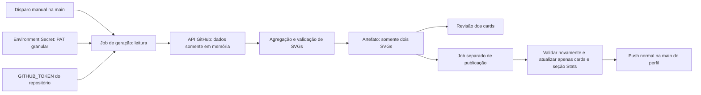

# Estatísticas agregadas do perfil — preparação para revisão

Estado: **não ativado**. Nenhum Secret cadastrado, workflow executado ou SVG real
gerado durante a implementação. Não houve commit nem push. O README continua com
os cards públicos existentes; a troca pelos SVGs locais só ocorre na publicação
explicitamente autorizada do workflow.

## Arquitetura recomendada



O workflow aceita somente `workflow_dispatch`. O job de geração ainda exige
`PROFILE_STATS_ENABLED=true`, o ator `paesdj1987` e a branch `main`.
Não há agendamento. O job de publicação está bloqueado com **`if: ${{ false }}`**:
nenhuma variável ou entrada do disparo pode habilitá-lo. Uma publicação futura
exige autorização e alteração de código revisada, além das proteções do environment.

O gerador usa a biblioteca padrão do Python, sem instalar pacotes e sem baixar
código dos projetos privados. Recebe metadados de repositórios, linguagens e
commits da API; descarta nomes, URLs, mensagens e identificadores antes de renderizar.
Nenhuma resposta JSON, inventário de repositórios ou checkout privado é persistido.

## Avaliação das ferramentas solicitadas

| Opção | Avaliação para este perfil |
| --- | --- |
| GitHub Stats Extended | Sucessor mantido do GitHub Readme Stats. Permite renderização autenticada e personalização. A documentação de deployment avisa que seu modo com PAT granular limita commits a repositórios públicos. A instância pública não recebe acesso aos seus repositórios privados por habilitar “Private contributions”. |
| GitHub Readme Stats Action | Gera SVGs com o núcleo do Extended. Sua documentação indica PAT clássico com `repo` e `read:user` para dados privados. A revisão de `action.yml` e `action.js` identificou instalação do núcleo em runtime, versão padrão variável e mensagens de erro da biblioteca encaminhadas aos logs. |
| Gerador local preparado | Escolhido para restringir a credencial a leitura granular, controlar os campos consultados e aplicar um vocabulário fechado no SVG. Não usa a Action externa de estatísticas nem seu núcleo npm. Usa apenas Actions oficiais para checkout e transporte de SVGs. |

A revisão da Action foi feita no commit
`2c498845f71017821efaad14293ebc736156ef21`; a referência consultada do Extended foi
`a09cb14b45d902cb924eac187bbcfd50e75e3efe`. Isso não constitui auditoria completa
das dependências dessas ferramentas. Fixar apenas a Action não fixa dependências
que ela instala dinamicamente. O escopo clássico `repo` também permite escrita;
por isso ele não foi escolhido para esta implementação.

A limitação documentada de commits com PAT granular no Extended não é uma
limitação do endpoint REST de commits por repositório. O gerador preparado usa
esse endpoint com `Contents: read`, em vez da busca global de commits usada
pelos cards de histórico. Isso permite contar commits privados autorizados,
com o escopo e o intervalo declarados abaixo. A integração real ainda precisará
ser validada na primeira execução autorizada.

## Métricas e cobertura exatas

| Métrica | Origem e significado | Dados privados |
| --- | --- | --- |
| Contribuições · calendário | `contributionCalendar.totalContributions` na API GraphQL, no intervalo fixado de 365 dias. Consulta separada usando o `GITHUB_TOKEN` limitado ao repositório do perfil. | **Cobertura privada não comprovada**, avisada no próprio card. Não é soma de commits. A opção de visibilidade do perfil não prova que a API retorna o mesmo agregado para essa credencial. |
| Commits · branches padrão | Resolve uma única vez o SHA da branch padrão de cada repositório e percorre o histórico alcançável a partir desse SHA. A API filtra `author=paesdj1987`, `since` e `until`; a autoria retornada também é conferida. SHAs repetidos contam uma vez, inclusive entre repositórios. | Inclui commits públicos e privados retornados pela API para os repositórios autorizados. O PAT granular precisa de `Contents: read`. |
| Repositórios analisados | Quantidade de repositórios próprios, sem forks, efetivamente retornados e processados. | Soma públicos e privados, sem separar as categorias e sem divulgar nomes. |
| Linguagens | Soma dos bytes de código por linguagem nos mesmos repositórios; top 7 mais “Outras”, com o restante no denominador. | Inclui públicos e privados autorizados. O endpoint requer `Metadata: read`. É uma fotografia atual, sem filtro de 365 dias. |

Os cards preservam fundo `0d1117`, título `58a6ff`, texto `c9d1d9`, borda
`30363d`, destaque ciano `22d3ee`, bordas arredondadas e larguras 440/340.
A altura é igual nos dois cards. A segunda imagem passa a mostrar agregados de
linguagens, em vez de depender do serviço público Top Languages.

Limitações:

- O PAT preparado tem resource owner `paesdj1987`. Não cobre automaticamente
  repositórios de organizações ou de outros proprietários. Cobrir esses casos
  exige uma autorização separada e revisão da implementação; não amplie para
  PAT clássico silenciosamente.
- Somente os repositórios próprios que o token consegue listar entram nas
  métricas REST. Selecionar menos repositórios produz cobertura parcial; a API
  não revela quais repositórios foram omitidos por falta de acesso. “Todos” não
  pode ser inferido comparando com números antigos de inventário.
- Forks são excluídos; arquivados são incluídos. A contagem considera o histórico
  alcançável pelo SHA capturado da branch padrão, não todos os commits de todas
  as branches. Autores não vinculados à conta ou históricos inacessíveis ficam
  fora ou causam interrupção por autoria inconsistente. Os filtros temporais
  são os do endpoint REST, não necessariamente os critérios do calendário nativo.
  Mover a branch depois de resolver o SHA não muda a referência usada nas páginas;
  se o SHA ficar inacessível, a coleta falha. Não há snapshot atômico de todos os
  repositórios; linguagens e metadados podem ser atualizados durante a execução.
- Calendário e commits têm critérios, autoria e escopos distintos. Mesmo com
  o mesmo intervalo eles não devem ser forçados a coincidir.
- Linguagens descrevem o conteúdo atual dos projetos, inclusive contribuições
  de outras pessoas. Não medem proficiência ou autoria. Linguagens fora da lista
  permitida viram “Outras”; nenhum texto livre vindo da API é publicado.
- Erros de autorização, rate limit, respostas parciais GraphQL, falhas HTTP ou
  paginação acima do limite interrompem a geração. O workflow não substitui
  falhas por zeros nem sobrescreve os cards anteriores com um card de erro.
- Paginação segue `Link`, inclusive em páginas curtas. Host, HTTPS, caminho,
  filtros, tamanho de página e sequência de páginas são verificados. Links
  externos, repetidos, malformados ou inconsistentes causam falha. O limite é
  de 1.000 páginas por consulta; atingir o limite com próxima página também falha.
- O gerador exige ao menos um repositório privado acessível para evitar uma
  execução silenciosamente limitada ao público. Isso não garante acesso a todos.
- Os SVGs são estáticos, datados e só mudam após uma execução aprovada. O GitHub
  ainda pode manter cache de imagens. Não há atualização em tempo real.
- Os próprios agregados revelam informações de alto nível: volume de atividade
  e tecnologias usadas. Esse é o conteúdo público autorizado por este projeto;
  não há divulgação de nomes ou identificação de projetos privados.

## PAT de leitura: criação manual após aprovação

Não cole o token na conversa, em comandos de terminal, em arquivos `.env`, no
README, em URLs ou no histórico do Git. Não use o PAT para publicar os SVGs.

1. No GitHub, abra **Settings → Developer settings → Personal access tokens →
   Fine-grained tokens → Generate new token**.
2. Nome sugerido: `profile-stats-read`. Escolha uma expiração curta, como 30 dias,
   e planeje a renovação. Resource owner: **paesdj1987**.
3. Em **Repository access**, prefira **Only select repositories** e selecione
   explicitamente seus repositórios públicos e privados que podem entrar no
   agregado. Para repositórios novos, atualize essa seleção manualmente.
4. Em **Repository permissions**, configure somente:

   | Permissão | Nível | Uso |
   | --- | --- | --- |
   | Metadata | Read-only, normalmente obrigatório | Listar repositórios autorizados e seus agregados de linguagens. |
   | Contents | Read-only | Listar metadados dos commits na branch padrão. Não há checkout dos projetos. |

5. Deixe as demais permissões de repositório e todas as permissões de conta
   sem acesso. Não conceda Actions, Workflows, Administration, Secrets ou escrita.
   Não é necessário `read:user` clássico: o calendário é consultado com o
   `GITHUB_TOKEN`, e os commits privados são contados pelo endpoint REST com
   autorização de leitura por repositório.
6. Gere o token e cadastre-o imediatamente pelo formulário de Secrets descrito
   abaixo. Se perder o valor, gere outro; não o salve no projeto.

O PAT granular tem acesso de leitura ao conteúdo dos repositórios selecionados,
embora o script consulte somente metadados. Quem conseguir executar código
malicioso com esse Secret poderá abusar dessa leitura. A seleção restrita e as
proteções de environment são, portanto, parte da configuração necessária.

## Configuração manual no repositório do perfil

Somente depois de revisar e autorizar a publicação destes arquivos:

1. Em `paesdj1987/paesdj1987`, abra **Settings → Environments**.
2. Crie o environment **profile-stats-read**. Restrinja deployment branches a
   `main` e configure um required reviewer de confiança. Em seus **Environment
   secrets**, crie **PROFILE_STATS_READ_TOKEN** e cole o PAT diretamente no
   formulário do GitHub. Não crie esse Secret em nível de repositório: o
   isolamento por environment evita sua disponibilidade no job de publicação.
3. Crie **profile-stats-publish**, também restrito a `main`, com aprovação manual.
   Esse environment **não deve conter o PAT de leitura**.
4. Confirme que o plano e as políticas da conta permitem essas proteções em
   repositório público. Não conte com a existência do nome do environment como
   garantia de aprovação: required reviewers precisam ser configurados.
5. Em **Settings → Secrets and variables → Actions → Variables**, cadastre
   **PROFILE_STATS_ENABLED** em **Repository variables** (não em Environment
   variables). Essa variável é consultada no `if` do job antes de iniciar o
   environment; uma variável exclusiva de environment não atende esse bloqueio.
   Cadastre o valor `true` somente quando estiver pronto
   e tiver autorizado o primeiro teste autenticado de leitura. Sem essa variável
   o job de geração é ignorado. Não há `schedule`, entrada `publish` ou controle
   por `PROFILE_STATS_AUTO_PUBLISH` nesta versão. A publicação está bloqueada no YAML.

   Esta variável não é um Secret. Já **PROFILE_STATS_READ_TOKEN** deve continuar
   sendo um **Environment secret** exclusivo de `profile-stats-read`. Não duplique
   o PAT em Repository secrets nem no environment de publicação. Nenhuma variável
   ou credencial foi cadastrada automaticamente durante a preparação.
6. Não habilite `ACTIONS_STEP_DEBUG` nem `ACTIONS_RUNNER_DEBUG` para este fluxo.
   Não altere o gerador para imprimir respostas, erros da API ou nomes privados.
7. Preserve a proteção da `main` e revise mudanças em workflow/scripts. As
   regras da branch podem impedir o push do bot; nesse caso ele falhará e será
   necessário revisar uma estratégia de publicação por PR. Não há bypass ou
   force push configurado.

O `GITHUB_TOKEN` da geração tem `contents: read` somente no perfil. O da
publicação tem `contents: write` somente nesse repositório. Ele é efêmero,
não permite ler os outros projetos privados e não precisa ser cadastrado como
Secret manual. O PAT granular não precisa de permissão de escrita.

## Revisão e primeira execução — não realizadas nesta preparação

1. Revise `scripts/profile_stats.py`, seus testes e o workflow antes de publicar.
   Revise também os SHAs das Actions oficiais fixadas no YAML. Não os substitua
   por tags móveis sem nova revisão.
2. Somente depois da autorização, publique os arquivos na `main`. O workflow não
   tem gatilhos de push, pull request, `pull_request_target`, `workflow_run` ou
   agendamento. O bloqueio `PROFILE_STATS_ENABLED` continua sendo necessário.
3. Configure os environments, Secret e variável. Vá a **Actions → Prepare
   aggregated profile stats → Run workflow** e selecione `main`.
   Não há opção de publicar. Aprove o environment de leitura quando solicitado.
4. Baixe e inspecione o artefato `profile-cards`. Ele deve conter somente
   `stats.svg` e `top-langs.svg`, com métricas agregadas e datas, sem URLs privadas,
   mensagens, identificadores ou nomes de projetos. Retenção configurada: 1 dia.
5. Faça as verificações autenticadas descritas abaixo. Nenhuma execução atual
   pode publicar, mesmo que os environments sejam aprovados.
6. Uma futura ativação de publicação requer autorização e uma alteração revisada
   no `if: false`. O job separado já está preparado para validar os artefatos,
   gravar somente os bytes canônicos validados em `profile/`, ajustar apenas
   GitHub Stats no README e conferir os bytes dos blobs no índice do Git antes
   de qualquer commit. Se a `main` tiver mudado, a publicação para; não há force push.

Não foram criados SVGs fictícios ou uma prévia com números reais nesta etapa.
Os testes usam valores sintéticos apenas em memória e pastas temporárias.
Até a primeira publicação aprovada, os cards atuais continuam públicos e não
devem ser apresentados como se já incorporassem os dados privados.

## Validação autenticada posterior, sem publicação

Esta etapa ainda não foi autorizada nem executada. Quando houver autorização:

- Confira no GitHub a expiração, as permissões de leitura e a seleção do PAT.
  Compare a quantidade de repositórios analisados com a seleção pretendida,
  descontando forks e outros proprietários. A existência de um privado não prova
  acesso a todos os privados pretendidos; não divulgue o inventário em logs.
- Compare amostras de commits na UI com os filtros de autoria, intervalo UTC e
  histórico alcançável pelo SHA capturado. Não publique SHAs ou nomes privados
  para demonstrar a comparação. Não compare esse total com o calendário como
  se ambos contassem o mesmo tipo de atividade.
- Confira o agregado do calendário com a mesma janela e com as limitações da
  credencial utilizada. Se a cobertura privada não puder ser comprovada, mantenha
  o aviso permanente do card ou autorize uma mudança para omitir esse indicador.
  Não acrescente `read:user`, escrita ou PAT clássico automaticamente.
- Confirme que o card de linguagens é uma fotografia dos bytes, não atividade
  dos últimos 365 dias. Compare o agregado sem anexar respostas JSON privadas.
- Inspecione os dois SVGs baixados e valide-os localmente com o comando
  `python scripts/profile_stats.py validate --directory CAMINHO_DO_ARTEFATO`.
  Não são necessárias credenciais para esse comando.
- Verifique que o job de publicação ficou **skipped**, nenhum commit foi criado
  e o README remoto permaneceu igual. Registre apenas aprovação/reprovação e
  totais agregados autorizados, nunca tokens, respostas brutas ou nomes privados.

## Automação posterior

Não existe agendamento nesta versão. Habilitar cron ou publicação exige nova
autorização e revisão de código, incluindo as proteções de evento e de environment.
Não há ativação remota realizada por esta preparação.

## Segurança e validação

- Apenas Actions oficiais de checkout/upload/download, fixadas em SHA completo.
  Elas continuam sendo dependências de terceiros e devem ser reavaliadas quando
  atualizadas. Os SHAs foram consultados na API oficial, sem executar as Actions.
- `persist-credentials: false`; sem checkout de forks, branches arbitrárias ou
  código privado; o código executado vem do SHA revisado na `main`.
- O PAT é injetado somente no processo Python de coleta. Logs de erro são
  genéricos; não incluem exceções, tracebacks ou payloads da API.
- A API só é consultada em `api.github.com`, com TLS verificado. Redirecionamentos
  HTTP são rejeitados para evitar encaminhar Authorization a outro destino.
- SVGs são lidos como bytes UTF-8. O parser aceita exatamente uma declaração do
  namespace SVG padrão. Declarações adicionais, reset de namespace, atributos
  namespaced, entidades, DTDs, comentários e instruções XML são rejeitados.
  Os valores agregados são extraídos de posições conhecidas, o SVG é reconstruído
  com o renderizador local e exige-se igualdade byte a byte. Isso também rejeita
  espaços ocultos, codificações alternativas, atributos extras, URLs e metadados.
  Os únicos elementos do formato canônico são `svg`, `rect` e `text`.
- O par completo é validado antes da gravação. `prepare` grava o snapshot em
  memória já validado; não copia novamente um artefato mutável. Os arquivos são
  relidos como bytes e revalidados. `verify-index` exige que o blob preparado no
  Git seja byte a byte igual ao arquivo canônico. Ambos existem apenas no job
  de publicação bloqueado; não foram usados para preparar commits nesta etapa.
- Somente os dois SVGs são enviados como artefato; respostas brutas não são
  armazenadas. Não há cache de metadados privados entre execuções.
- O job de publicação revalida os dois arquivos e inclui explicitamente apenas
  `README.md`, `profile/stats.svg` e `profile/top-langs.svg` no commit.
- Nenhum mecanismo elimina riscos de mudanças maliciosas na `main`, comprometimento
  do runner ou abuso por alguém autorizado a aprovar environments. Menor privilégio,
  revisão de código e expiração do Secret reduzem esses riscos.

Validação local sem credenciais:

```text
python -m unittest discover -s scripts -p test_profile_stats.py -v
```

Esse comando não executa workflow, não consulta a API e não gera SVGs públicos.
A suíte usa somente a biblioteca padrão e credenciais sintéticas sem validade.
Inclui os testes anteriores e as regressões de namespace, bytes canônicos,
paginação, SHA fixo, falhas de autenticação, rate limit, logs e isolamento.
A integração autenticada só poderá ser confirmada após a execução autorizada;
antes disso, o comportamento real do PAT e a cobertura privada não estão testados.

## Documentação consultada

- [GitHub Stats Extended](https://github.com/stats-organization/github-stats-extended)
- [Deployment e limitações dos tokens no Extended](https://github.com/stats-organization/github-stats-extended/blob/a09cb14b45d902cb924eac187bbcfd50e75e3efe/apps/frontend/src/content/docs/docs/deploy.md)
- [GitHub Readme Stats Action](https://github.com/stats-organization/github-readme-stats-action)
- [Código da Action revisado](https://github.com/stats-organization/github-readme-stats-action/tree/2c498845f71017821efaad14293ebc736156ef21)
- [Permissões para listar repositórios e linguagens](https://docs.github.com/en/rest/repos/repos)
- [Permissões e filtros de commits](https://docs.github.com/en/rest/commits/commits#list-commits)
- [Tipos de token e criação de PAT granular](https://docs.github.com/en/authentication/keeping-your-account-and-data-secure/managing-your-personal-access-tokens)
- [Contribuições e visibilidade privada](https://docs.github.com/en/account-and-profile/reference/profile-contributions-reference)
- [GraphQL User e ContributionsCollection](https://docs.github.com/en/graphql/reference/users)
